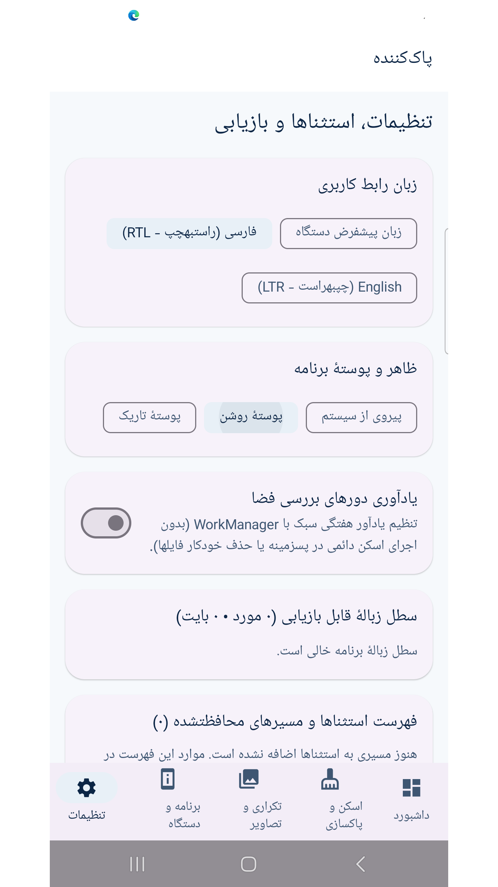
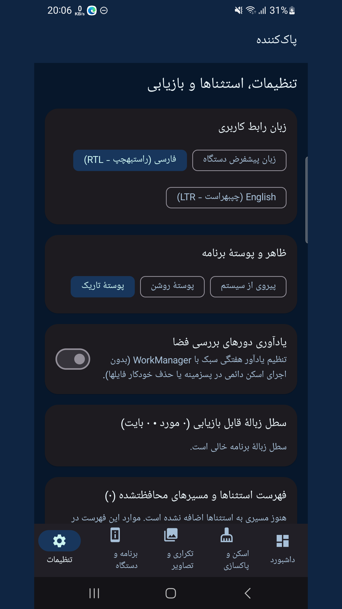
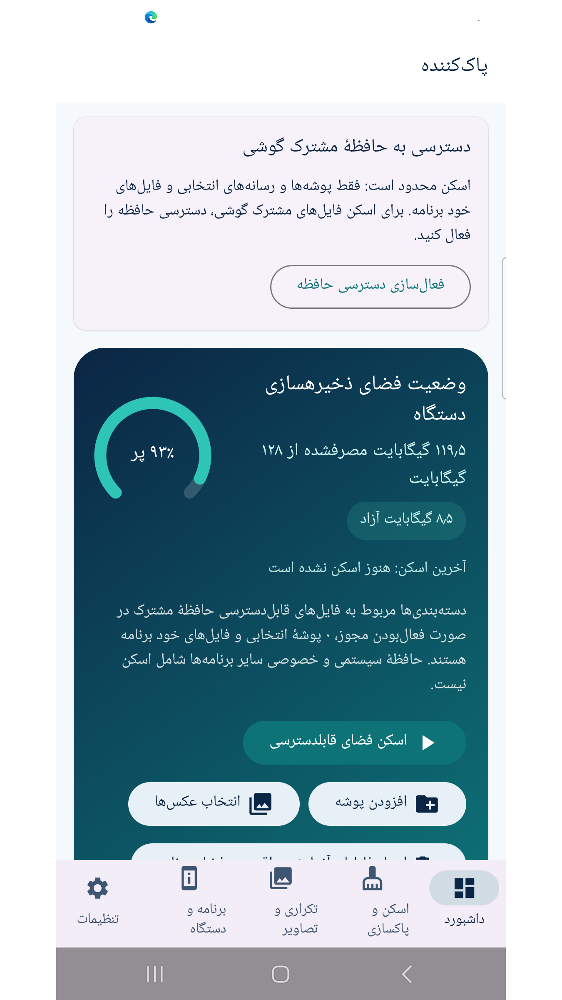
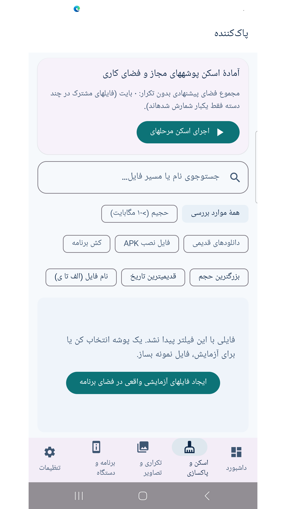
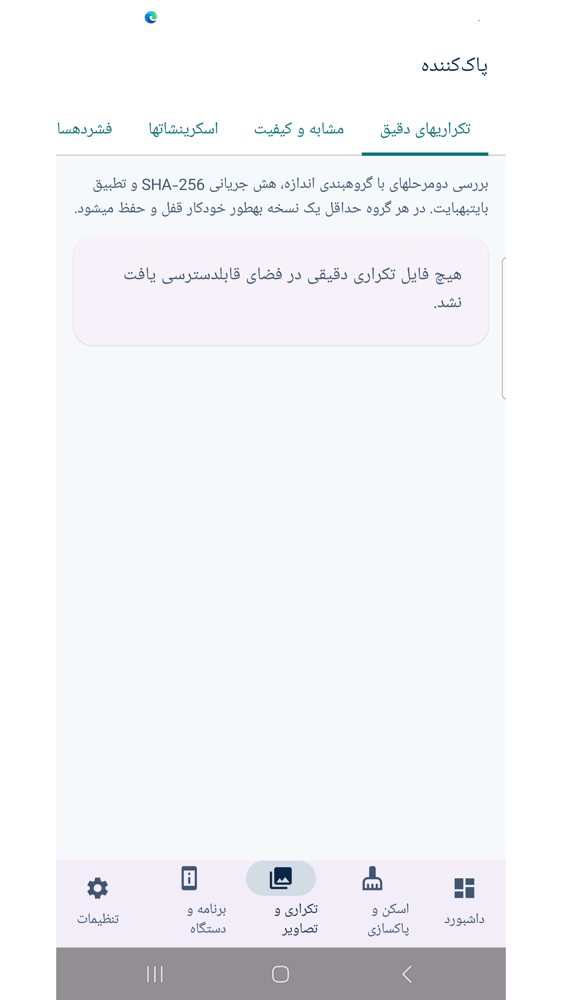
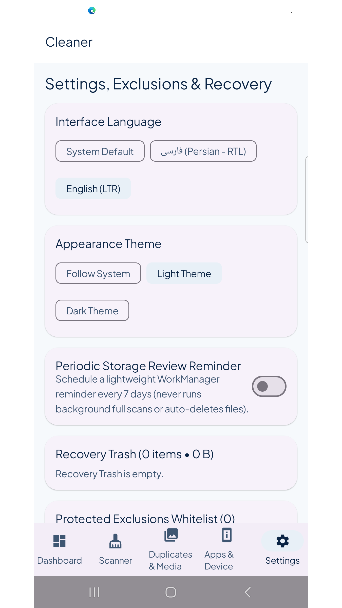
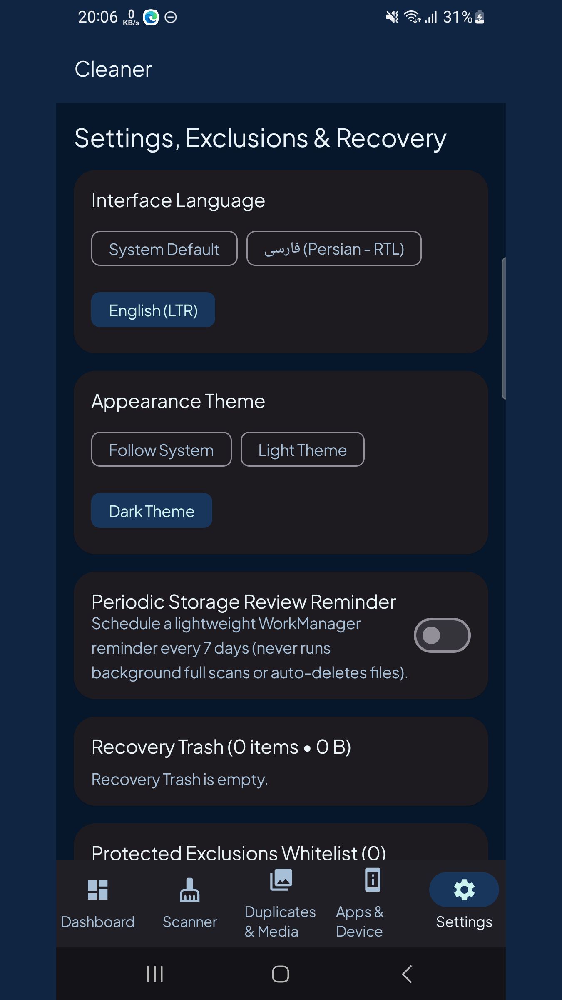
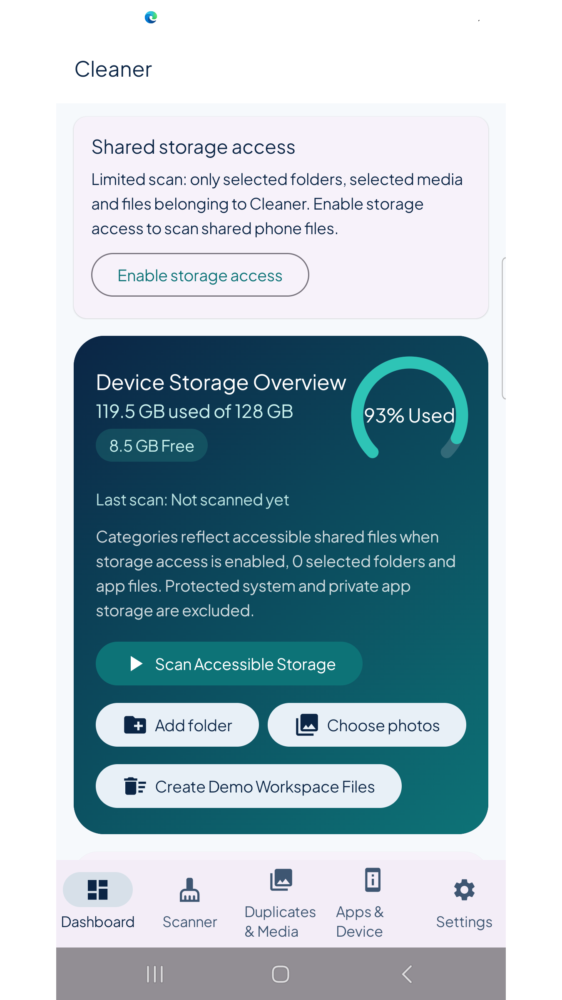
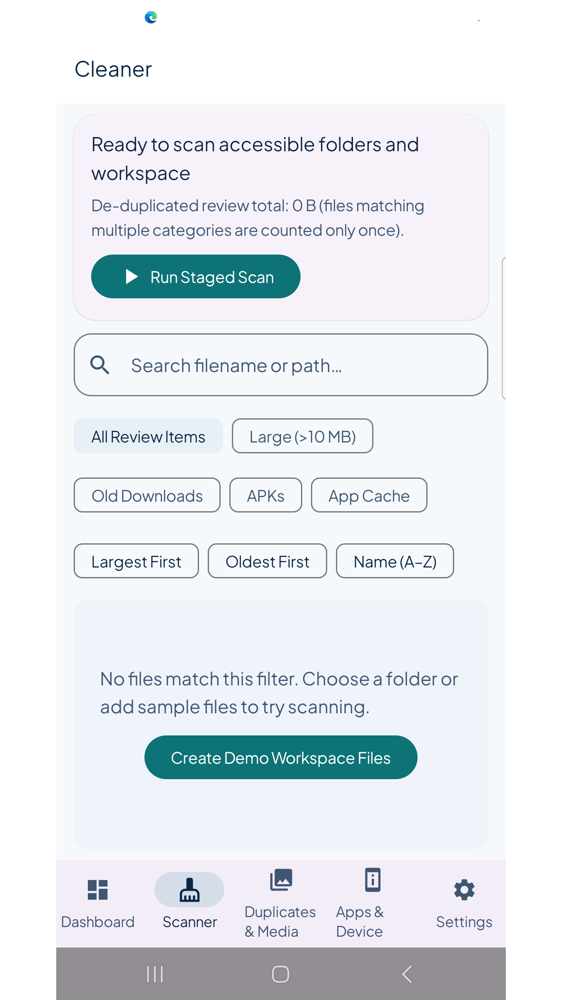
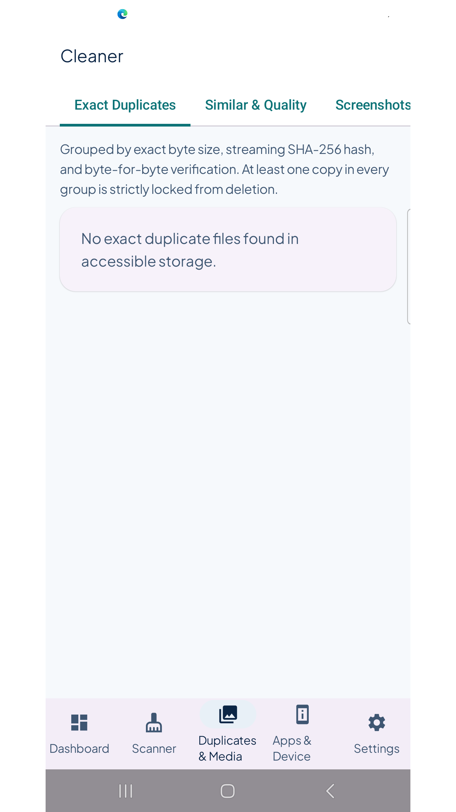

# Cleaner | پاک‌کننده

[Download / دریافت APK](https://github.com/cinaasadpour-hash/cleaner/releases/tag/v1.0.2)

Package: `com.sinatools.cleaner` · Version: **1.0.2** · Version code: **3**

## فارسی

بررسی حافظه، فایل‌های حجیم و تکراری، سطل بازیابی و فشرده‌سازی عکس.

پاک‌کننده به بررسی فضای ذخیره‌سازی، فایل‌های حجیم، فایل‌های تکراری و تصاویر کمک می‌کند. نتیجه‌ها را بازبینی کنید و فقط فایل‌هایی را که لازم ندارید انتخاب کنید. حذف یا انتقال به سطل پس از تأیید شما انجام می‌شود.

برای اسکن حافظهٔ مشترک گوشی و کارت حافظه، می‌توانید مجوز مدیریت همهٔ فایل‌ها را از داشبورد و تنظیمات اندروید فعال کنید. بدون این مجوز، انتخاب پوشه و عکس همچنان در دسترس است. داده و کش خصوصی سایر برنامه‌ها و پوشه‌های محافظت‌شدهٔ اندروید قابل بررسی نیستند.

سطل بازیابی امکان برگرداندن فایل را پیش از تخلیه فراهم می‌کند. انتقال به سطل تا زمان تخلیه الزاماً فضا آزاد نمی‌کند. ابزار فشرده‌سازی عکس، نسخهٔ جدید می‌سازد و اصل عکس را حفظ می‌کند. رابط فارسی و انگلیسی و حالت روشن و تاریک در دسترس است.

## English

Review storage, large and duplicate files, recovery trash and image compression.

Cleaner helps you review storage use, large files, exact duplicates and images. Review results and select only files you no longer need. Deletion or moving files to recovery trash requires your confirmation.

To scan shared phone storage and an accessible SD card, optionally enable all-files access from the dashboard and Android settings. Folder and photo selection remain available without this permission. Other apps' private data and caches and protected Android directories remain inaccessible.

Recovery trash lets you restore files before emptying it. Moving files to trash does not necessarily free storage until the trash is emptied. Image compression creates a new copy and preserves the original. Persian and English interfaces and light and dark themes are available.

## Privacy / حریم خصوصی

See [Privacy / حریم خصوصی](PRIVACY.md). Store listing text in both languages is available in [store-listing](store-listing).

## Verification / بررسی

The signed APK was installed and launched on a Samsung Galaxy A32 with Android 13 on 2026-10-30, with existing app data preserved. The installed APK checksum matched the release file. Production Tapsell identifiers and the release certificate were checked in the APK. Detailed visual and functional coverage varies by app; this is not a guarantee of compatibility with every device or external service.

نسخهٔ امضاشده در ۳۰ اکتبر ۲۰۲۶ روی گوشی نصب و اجرا شد و اطلاعات قبلی حفظ شد. اثرانگشت نسخهٔ نصب‌شده با فایل انتشار برابر بود. نام بسته، امضا و شناسه‌های واقعی تپسل در APK بررسی شدند. محدودهٔ آزمون هر برنامه متفاوت است و سازگاری با همهٔ دستگاه‌ها و خدمات تضمین نمی‌شود.

## تصاویر برنامه

## Screenshots

